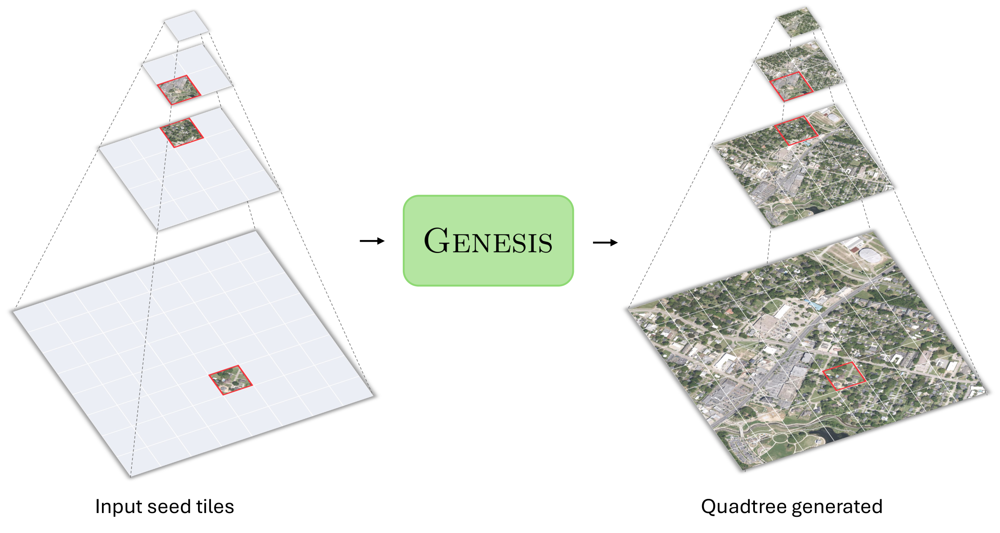
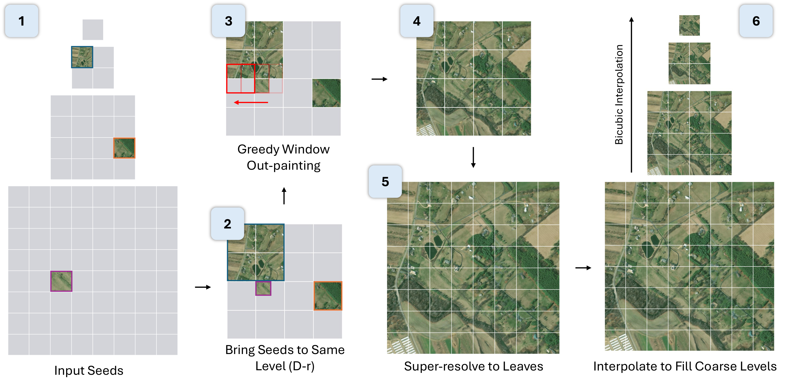

# Genesis

**A Generative Engine for Hierarchical Satellite Image Synthesis** — SIGSPATIAL'26.

Genesis completes a sparse set of seed satellite tiles into a full, zoomable Web-Mercator
**quadtree** — filling every scale and location — with two flow-matching *JiT* operators
(parent-conditional super-resolution + mask-based outpainting) composed into one pyramid engine.



## How it works

From the input seeds, the pyramid engine (1) takes the seed tiles, (2) brings them to a common
working level, (3) greedily out-paints to complete that level, (4–5) super-resolves down to the
leaf tiles, and (6) fills the coarser levels by downsampling — yielding a pyramid that is
consistent across scales and honors every seed.



## Repository

```
src/
├── superresolution/   # Parent-conditional 256 → 512 SR (ZL → ZL+1)
├── outpainting/       # Mask-based 256×256 image completion
├── pyramid/           # Full-pyramid generation engine (multi-scale tile completion)
├── eval/              # Per-sample + pyramid evaluation
├── dataprep/          # One-shot scripts to build the shared meta + hierarchy
└── util/              # Shared building blocks (RoPE, RMSNorm, sin-cos pos embed)
```

## Documentation

| Guide | What |
|-------|------|
| [`docs/EVALUATION.md`](docs/EVALUATION.md) | evaluate the released models on the paper's benchmarks |
| [`docs/TRAINING.md`](docs/TRAINING.md) | train the SR & OP operators |
| [`docs/HYPERPARAMETERS.md`](docs/HYPERPARAMETERS.md) | every training/eval hyperparameter + sample count (paper vs. code) |
| [`docs/METRICS.md`](docs/METRICS.md) · [`docs/METRICS_DENSE500.md`](docs/METRICS_DENSE500.md) | metric definitions (tile · pyramid) |
| [`demos/README.md`](demos/README.md) | interactive Gradio demos |

## Installation

Uses [uv](https://docs.astral.sh/uv/). From the repo root:
```bash
uv sync                     # creates .venv, installs the pinned deps (Python 3.13, torch 2.8 cu128)
source .venv/bin/activate   # or prefix commands with `uv run`
```
Checkpoints, datasets, and weights are **not** part of the environment — they download on first
use (below). For CPU-only, drop the `pytorch-cu128` index in `pyproject.toml` first.

## Data & weights — all on Hugging Face or Google Drive

Every external artifact is fetched automatically on first use — nothing lives on a private path.

| Artifact | Hosted on | How it's obtained |
|----------|-----------|-------------------|
| Git-10M tiles | 🤗 `lcybuaa/Git-10M` | `datasets.load_dataset(...)` (override cache with `$HF_DATASETS_CACHE`) |
| Split meta + hierarchy index | Google Drive `shared/` | auto-pull to `$GENESIS_CKPT_BASE/shared/` (rclone `gdrive:`) |
| dense500 benchmark | 🤗 `dcher95/dense500` | auto-download via `pyramid.dataset.GlobalDense` |
| Checkpoints (main **and** ablation) | Google Drive release | auto-pull to `$GENESIS_CKPT_BASE` (`--exp main_b16 / main_h16 / abl_*`) |
| DINOv3-sat encoder weights | Google Drive release | auto-pull; override with `$GENESIS_DINO_WEIGHTS` |

Google-Drive pulls need an rclone remote named `gdrive` (folder
`1OKe2YRJFkwwFD3GWXVJMEr6qKGJz0qyA`, shared "anyone with the link"): `rclone config` → `n` → `drive`
→ accept defaults → OAuth. Files cache under `$GENESIS_CKPT_BASE` (default `<repo>/logs/ckpts/`).
To pre-download everything: `bash src/eval/download_ckpts.sh` (details in
[`docs/EVALUATION.md`](docs/EVALUATION.md)).

## Quick start — Demo

The main demo is the **full-pyramid generator**: drop sparse seed tiles on a map and Genesis
completes the entire multi-scale quadtree.

```bash
export GENESIS_CKPT_BASE=/path/to/ckpt_cache   # where Google-Drive ckpts land (rclone `gdrive` remote)
python demos/app_pyramid_unified.py            # opens a Gradio app; prints a local + shareable URL
```

Click the map to drop seeds → **Generate**; the main B/16 + H/16 checkpoints auto-pull from Google
Drive on first use. Other apps (per-tile SR, single-tile outpainting, deep 6-level pyramid,
no-model interpolation baselines) are in [`demos/README.md`](demos/README.md).

## Train / evaluate

- **Train** the operators → [`docs/TRAINING.md`](docs/TRAINING.md)
- **Reproduce the paper tables** → [`docs/EVALUATION.md`](docs/EVALUATION.md)

Both use the same auto-downloaded checkpoints/data for the Genesis JiT-B/16 & JiT-H/16 models.

## License

Released under the MIT License — see [`LICENSE`](LICENSE).
